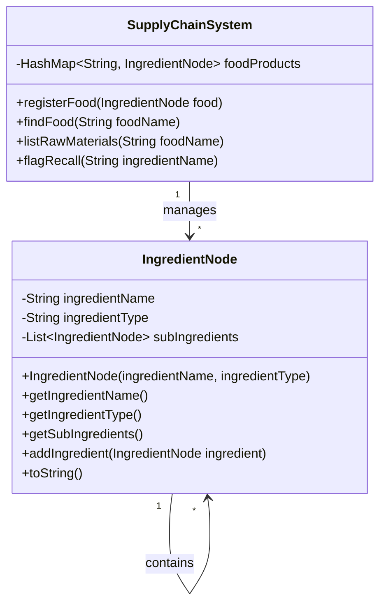

## 1. UML Diagram

## 2. Data Structure Selection

## ArrayList<IngredientNode>

I chose an ArrayList to store the ingredients inside each IngredientNode. A finished food product can contain multiple ingredients, and some of those ingredients can contain other ingredients. By using an ArrayList it makes it easier to keep track of the ingredients connected to each node and go through them when searching the tree.

## HashMap<String, ingredientNode>

A HashMap will be used to store finished food products using their food names as keys. This is useful because the program needs to find specific food products when checking their ingredients or processing a recall. Instead of searching through every food product one at a time, a HashMap allows the program to find them in O(1) average time.

## Tree Structure

I chose a tree for the food products because the ingredients within the food will not be stored as just a long list. Some ingredients can contain other ingredients, creating multiple levels and complex combinations. For example, a finished meal can contain sauce, and the sauce can contain tomatoes and garlic. A tree represents these relationships by allowing each node to have multiple children. This also makes recursion useful because the program can repeat the same search through each branch until it reaches the raw materials.

## 3. Big-O Expectations

Register a food product: O(1) average
A food product can be added to the HashMap using its food name as the key.
Find a food product: O(1) average
The HashMap can access a food product directly using its key.
Adding an ingredient: O(1) amortized
Adding an ingredient to an ArrayList usually takes constant time.
Listing raw materials: O(n)
The program may need to visit every node in the tree to find all raw materials.
Flag a recall: O(n)
The program needs to search through all registered food product trees to find every product containing the contaminated ingredient.

Here, n represents the total number of ingredient nodes being searched. The recall operation may need to check every registered food product and its ingredients.
